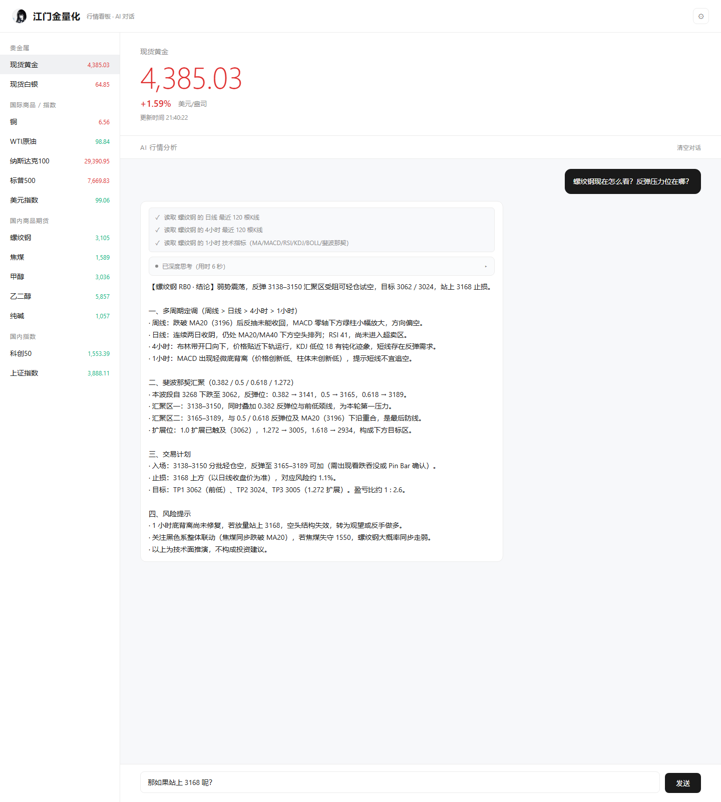

# 江门金量化 · AI 多周期行情解读助手

> 一个 Windows 桌面工具：左边实时行情看板，右边 AI 对话。把 7 个周期的 K 线与技术指标自动组装成上下文喂给大模型，让它按专业交易框架给出带点位和风控的盘面解读，而不是泛泛而谈。

行情软件只给数据不给解读，通用大模型又看不到实时行情。这个项目要解决的就是这两者之间的空档：**一次点击拿到"数据 + 解读 + 点位"的完整闭环**。



## 功能

| 能力 | 说明 |
| --- | --- |
| 实时行情看板 | 25 个品种、5 个分组（贵金属 / 国际与港股 / 国内商品期货 / 国内指数与 ETF / 汇率），单窗口并行刷新，7 类数据源自动路由 |
| 多周期 K 线 | 周 / 日 / 12H / 4H / 1H / 15M / 5M 共 7 个周期，缺失周期由低周期重采样合成，带按周期粒度的缓存 |
| 技术指标 | MA、MACD、RSI、KDJ、BOLL、斐波那契回撤、量价背离，全部本地计算后注入提示词 |
| AI 对话 | OpenAI 兼容接口 + 流式输出（前端轮询增量），会话级上下文，支持中断 |
| AI 工具调用 | Agent 模式：模型可主动调用「读 K 线 / 读指标 / 查品种」等工具按需取数，不必一次性塞满上下文 |
| Skill 技能模板 | 分析框架以纯文本技能文件存放，用户可直接增删，无需改代码 |
| 相似问题缓存 | SQLite + 文本相似度，重复或近似提问秒级返回，省 token 也省等待 |
| 分析报告导出 | 由 AI 输出结构、程序负责出图（K 线 + 浪型 + 支撑压力 + 止盈止损），一键导出 `.md` 与自包含 `.html` |
| 单文件交付 | PyInstaller 打包，双击即用，目标机器无需装 Python |

## 技术栈

- **界面**：Python + pywebview（原生窗口套 WebView，前端是纯 HTML/CSS/JS，无框架）
- **行情**：AKShare + 新浪财经各市场行情接口，自建数据源映射与降级策略
- **AI**：OpenAI 兼容 Chat Completions（流式），自实现工具调用循环
- **存储**：SQLite（问答缓存）、JSON（配置与额度计数）
- **图表**：matplotlib（服务端出图，避免前端图表库的字体与导出问题）
- **打包**：PyInstaller（文件夹模式）
- **代码规模**：后端约 7.7k 行 Python，前端约 2.0k 行 HTML/CSS/JS

## 架构

```
┌──────────────────────────────────────────────────────────┐
│  pywebview 窗口                                           │
│  ┌───────────────┐        ┌────────────────────────────┐ │
│  │ 行情看板       │        │ AI 对话                     │ │
│  │ 25 品种 / 分组 │        │ 流式输出 / 工具调用可视化    │ │
│  └───────┬───────┘        └─────────────┬──────────────┘ │
└──────────┼──────────────────────────────┼────────────────┘
           │        js_api（Python ⇄ JS）  │
┌──────────┴──────────────────────────────┴────────────────┐
│  src/api.py          对外暴露的统一接口层                  │
├───────────────────────────────────────────────────────────┤
│  fetcher.py   后台刷新服务 + 数据源路由 + 降级             │
│  kline.py     多周期 K 线（重采样 / 缓存）                 │
│  indicators.py 指标计算      analysis.py 多周期报告         │
│  ai.py        流式调用      chat.py     会话与提示词组装    │
│  tools.py     工具注册      skills.py   技能加载            │
│  qacache.py   相似问题缓存  chart.py / report.py 出图与导出 │
│  mcp.py       标准 MCP 客户端（金十数据，可选）             │
│  netguard.py  全局网络超时保护                             │
└───────────────────────────────────────────────────────────┘
           │                    │                  │
      AKShare / 新浪        OpenAI 兼容 API    金十 MCP（可选）
```

设计上有一条硬约束：**数据链路只有一条**。AI 无论走「预注入上下文」还是「工具调用」，读到的都是同一套 `fetcher → kline → indicators` 结果，不存在两套口径互相打架的情况。

## 目录结构

```
├── main.py                 # 入口（含 --selftest 自检模式）
├── build.py                # PyInstaller 打包脚本
├── requirements.txt
├── deepseekproject.md      # 项目总指引（文档索引 + 开发约定）
├── docs/                   # 需求 / 技术方案 / 设计规范 / 执行步骤 / 日志规范
├── src/                    # 后端 19 个模块
├── web/                    # 前端（index.html / style.css / app.js）
├── skills/                 # AI 分析技能模板（纯文本，可直接增删）
├── tools/                  # 辅助脚本与分阶段自测
├── assets/                 # 图标等品牌素材
└── 开发日志/                # 每日开发记录
```

## 快速开始

```bash
git clone <repo-url>
cd jiangmenjinlianghua
python -m venv .venv
.venv\Scripts\activate          # Windows

pip install -r requirements.txt
python main.py
```

首次启动后在设置面板填入任意 OpenAI 兼容服务的 `Base URL` / `API Key` / 模型名即可对话。配置保存在本地 `config.json`（已在 `.gitignore` 中，不入库）。

自检与打包：

```bash
python main.py --selftest        # 校验行情 / 多周期 K 线 / 技能加载 / AI 工具四项
python build.py                  # 打包为 dist/ 下的文件夹模式产物
python build.py --onefile        # 单 exe（启动较慢）
```

可选：接入金十数据 MCP 时，通过环境变量 `JIN10_DEV_TOKEN` 提供 token，代码中不硬编码任何密钥。

## 工程上值得说的几点

**1. 网络请求必须有全局超时兜底。**
AKShare 底层走的是第三方接口，弱网或对方限流时会出现请求永久挂起，界面直接假死。`src/netguard.py` 在进程级给 socket 加默认超时，并在数据层做单品种失败隔离——一个品种拿不到数据，不影响其余 24 个。

**2. 周期矩阵不是所有品种都有。**
外汇没有周线、部分品种没有 5 分钟线。`src/symbols.py` 把「品种 × 可用周期」做成唯一事实源，`kline.py` 遇到缺失周期时按规则从低周期重采样或直接跳过，避免 AI 拿到空数组后编造结论。阶段 8 对 25 个品种 × 7 个周期做了双向断言测试。

**3. 流式输出用轮询而不是 WebSocket。**
pywebview 的 JS 桥只有「JS 调 Python」和「Python 返回」两个方向，Python 主动推送到前端要额外维护通道。这里用「Python 侧写缓冲区 + 前端定时拉增量」的轮询方案，代价是一次 100ms 的空请求，换来的是零额外依赖和可预期的中断行为。

**4. 提示词结构比提示词长度更重要。**
多周期上下文按权重排序（周线 → 日线 → … → 5 分钟），每个周期只带最近 120 根 K 线的统计摘要而不是原始数据。指标全部本地算完再注入，不让模型自己算——模型算 MACD 的准确率远低于 `pandas`。

**5. 出图交给程序，结构交给模型。**
早期版本让模型直接生成图表描述，价位标签经常重叠、坐标轴不可控。后来改为：模型只输出结构化的关键位（支撑 / 压力 / 止盈 / 止损），matplotlib 负责绘制并对同价位标签做合并去重。可复现，也不再出现"图上的线和文字对不上"。

**6. 打包最大的坑是隐式依赖。**
PyInstaller 不会自动收集 `py_mini_racer` 这类运行时才加载的二进制，漏打包的表现是「国内期货行情静默失败」——不报错，只是某些品种永远空白。因此 `main.py --selftest` 会在打包后逐项验证四大链路，作为发布前的强制门禁。

## 开发过程

项目按 10 个阶段推进，每个阶段先写验收标准、代码通过后更新文档再进下一阶段，提交历史按阶段切分，可以逐条对照：

| 阶段 | 内容 | 状态 |
| --- | --- | --- |
| 0 | 项目初始化：需求 / 技术方案 / 设计规范 / 执行步骤四份标准文档 | ✅ |
| 1 | 应用骨架 + 极简白色界面 | ✅ |
| 2 | AKShare 实时行情接入与后台刷新 | ✅ |
| 3 | AI 对话 + 流式输出 + 多周期上下文 | ✅ |
| 4 | Skill 技能系统 + 相似问题缓存 | ✅ |
| 5 | PyInstaller 打包与自检 | ✅ |
| 6 | AI 工具调用（Agent 模式） | ✅ |
| 7 | 金十数据 MCP 接入（8 个工具 + 额度保护 + 来源标注） | ✅ |
| 8 | 品种扩充至 25 个（新增港股 / 外汇 / 上金所数据源） | ✅ |
| 9 | 分析报告与图表（AI 出结构、程序出图、md/html 导出） | ✅ |

过程中的决策、踩坑和每次验收结论都记在 [`开发日志/`](开发日志/) 里，按天归档。

## 数据来源与说明

- 行情数据来自 AKShare 及新浪财经公开接口，仅供学习与研究使用，**不构成任何投资建议**。
- 项目不含任何 API Key、token 或用户数据；`config.json` 与运行期缓存均在 `.gitignore` 中。
- 金十数据为可选增强，需要自行申请开发者 token。

## License

MIT
